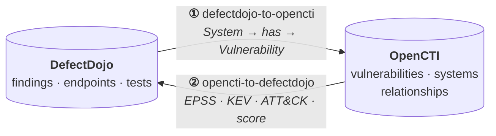

# opencti-defectdojo

Two-way synchronisation between [OpenCTI](https://github.com/OpenCTI-Platform/opencti) and
[DefectDojo](https://github.com/DefectDojo/django-DefectDojo).

The two platforms each hold half of what you need to prioritise a vulnerability. DefectDojo knows
which hosts are affected, because that is where scan findings land. OpenCTI knows how dangerous
each CVE is, because that is where EPSS, CISA KEV and MITRE ATT&CK data live. Neither is useful
alone: asset context without threat context gives you a list with no order, and threat context
without asset context tells you nothing about your own estate.

These two scripts close the loop in both directions.

| Direction | Script | What it moves |
|---|---|---|
| DefectDojo → OpenCTI | [`defectdojo-to-opencti`](defectdojo-to-opencti) | Affected hosts, as `System → has → Vulnerability` |
| OpenCTI → DefectDojo | [`opencti-to-defectdojo`](opencti-to-defectdojo) | EPSS, KEV, ATT&CK tags and contextual score |

## The loop



Order matters. Run `defectdojo-to-opencti` first so OpenCTI knows which systems are affected, then
`opencti-to-defectdojo` to write the resulting intelligence back onto the findings analysts work
from. Running them the other way round is harmless, but a given night's findings will lag a cycle
behind.

```cron
0 6 * * * cd /opt/scripts/defectdojo-to-opencti && set -a && . ./.env && set +a && python3 defectdojo_to_opencti.py >> /var/log/dd-to-oc.log 2>&1
0 7 * * * cd /opt/scripts/opencti-to-defectdojo && set -a && . ./.env && set +a && python3 opencti_to_defectdojo.py >> /var/log/oc-to-dd.log 2>&1
```

## ① DefectDojo → OpenCTI

For each active, non-duplicate DefectDojo finding carrying a CVE ID, creates a **System** entity in
OpenCTI and links it to the matching Vulnerability.

Two finding sources are handled differently:

| Source | System name | Alias | Label |
|---|---|---|---|
| **Wazuh** (test tagged `wazuh`) | Agent name (DD product name) | Endpoint IP | Wazuh group (product type) |
| **Mass scan** (Nessus, OpenVAS, auditor) | Endpoint host / IP | — | Product name |

The script builds its caches once at startup (product types, products, engagements, tests,
endpoints, and the full CVE list from OpenCTI), so the main loop makes no per-CVE lookups.

See [`defectdojo-to-opencti/README.md`](defectdojo-to-opencti/README.md).

## ② OpenCTI → DefectDojo

Enriches active DefectDojo findings with threat intelligence pulled from OpenCTI:

- `epss_score` and `epss_percentile`
- `known_exploited` (CISA KEV)
- ATT&CK technique tags, resolved from the CVE's `related-to` relationships
- Contextual score, written into the finding description

Fields come from the official EPSS and KEV connectors plus the
[`cve-score`](https://github.com/Tekila11/opencti-vuln-toolkit) connector. If those are not
running in OpenCTI, the corresponding fields come back empty rather than failing.

See [`opencti-to-defectdojo/README.md`](opencti-to-defectdojo/README.md).

## The relationship direction

Both scripts depend on one modelling rule, which is worth stating plainly because getting it
backwards fails silently.

Asset exposure is written as **`System → has → Vulnerability`**, never the reverse. A `has`
relationship pointing from a Vulnerability to a System is rejected by the OpenCTI API, and only
this direction populates the *Affected systems* field in the UI. The same constraint applies to
`Software → has → Vulnerability` elsewhere in the stack, and it is how the official CISA KEV
connector builds its relationships.

## Requirements

- Python 3.10 or newer
- OpenCTI 7.x, with `pycti` matching the platform release (both scripts pin `pycti==7.260318.0`)
- DefectDojo 2.x with an API token
- Network access from the host running these scripts to OpenCTI port 8080 and to DefectDojo
- An OpenCTI token with write access for ① (it creates System entities and relationships) and read
  access for ②
- CVEs already present in OpenCTI, imported by the official NVD CVE connector

`pycti` tracks the OpenCTI platform version, so if you run a different release, change the pin in
both `requirements.txt` files together.

## Installation

Each direction is self-contained, with its own `.env`, `requirements.txt` and `state.json`:

```bash
cd defectdojo-to-opencti
pip3 install -r requirements.txt
cp .env.example .env     # then fill in the values
set -a && . ./.env && set +a
python3 defectdojo_to_opencti.py
```

Repeat for `opencti-to-defectdojo`. The two can run on different hosts if that suits your network,
as long as each can reach both APIs.

## State

Both scripts keep a `state.json` recording what they have already processed, which makes re-runs
idempotent rather than duplicate-producing.

Deleting `state.json` forces a full reprocess. For `opencti-to-defectdojo` that means rewriting the
enrichment block in every finding description, which is slow and noisy on a large instance, so
check the script's own README before doing it.

## Related

Part of a set of integrations around DefectDojo and OpenCTI:

| Repository | Direction |
|---|---|
| [`wazuh-defectdojo`](https://github.com/Tekila11/wazuh-defectdojo) | Wazuh → DefectDojo |
| [`kaspersky-defectdojo`](https://github.com/Tekila11/kaspersky-defectdojo) | Kaspersky Security Center → DefectDojo |
| [`opencti-vuln-toolkit`](https://github.com/Tekila11/opencti-vuln-toolkit) | OpenCTI connectors for CVE enrichment and scoring |

## License

[MIT](LICENSE)
